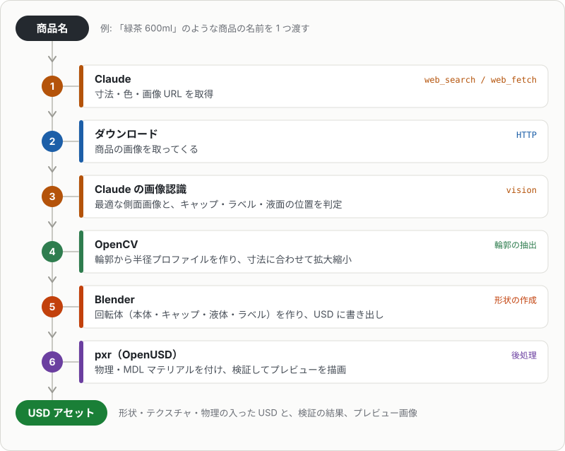

# agentic-usd-gen

Generate simulation-ready USD assets for NVIDIA Isaac Sim from a product name. Claude searches for the dimensions and images, Blender builds the 3D model, and OpenUSD (`pxr`) adds physics and materials and validates the result. A second entry point draws 565 fictional Japanese retail products and store fixtures without using any real brand, logo or product photo. The documentation is in Japanese. Licensed under Apache-2.0.

商品名から寸法と画像を検索し、Blender で 3D モデルを作って Isaac Sim 向けの USD を書き出すツールです。

> [!IMPORTANT]
> NVIDIA の公式のものではありません。Isaac Sim・Omniverse・SimReady は NVIDIA Corporation の商標です。

入口は 2 つあります。

| 入口 | 何をするか | API キー | 作ったアセットの公開 |
|---|---|---|---|
| `agentic-usd-gen "商品名"` | 実在の商品を検索し、商品ページの画像をテクスチャにして作る | 要る | できない（下の注意） |
| `agentic-usd-gen-fictional` | 架空の商品 565 点（商品・什器・内装）を、実在の商品名・ロゴ・商品写真を使わずに描いて作る（[docs/fictional.md](docs/fictional.md)） | 要らない | できる |

> [!CAUTION]
> `agentic-usd-gen "商品名"` で作ったアセットは、実在の商品の画像を含みます。画像の権利は元の権利者にあるので、そのアセット（テクスチャ・USD）を公開・再配布しないでください。検索や画像の取得が各サイトの利用規約に合っているかも、使う人の責任で確かめてください。公開するアセットは `agentic-usd-gen-fictional` で作ります。

対応形状（`shape_class`）は次の 4 つです。

- `revolve`: 回転体（ペットボトル・瓶・缶・カップ）
- `pouch`: ピロー包装の袋（ポテトチップスなど）
- `box`: 箱（菓子箱・ティッシュ箱・紙パックなど）
- `assembly`: 直方体と円柱の部品の組み合わせ（セルフレジ・デジタルサイネージ・棚などの什器）

`agentic-usd-gen "商品名"` の処理の流れ（回転体の場合）:



## 準備

- [uv](https://docs.astral.sh/uv/)
- Blender 4.x（macOS は `/Applications/Blender.app` に置くか、`--blender` / 環境変数 `BLENDER` で場所を指定）
- Anthropic API キー（実在の商品を検索して新しく作るときだけ。下記）

```sh
uv sync
cp .env.example .env   # 検索して作るときは ANTHROPIC_API_KEY=... を記入
```

> [!IMPORTANT]
> Blender 4.x が要ります。`src/agentic_usd_gen/blender/` のスクリプトは Blender の中で動き、Blender の Python API（`bpy`）を使います。Blender 本体は含みません。

> [!WARNING]
> 商品名から検索して作ると、Anthropic API の料金がかかります（既定のモデルは `claude-opus-5-5`。検索・画像認識・`--visual-check` で呼びます）。下の「キーがなくても動く」場合は、料金はかかりません。

API キーを使うのは、商品名から寸法・形状・画像を検索するとき（`search.py`）と、画像から使う 1 枚とキャップ・ラベルの位置を決めるとき（`vision.py`）だけです。次の場合はキーがなくても動きます。

- 検索キャッシュ（`cache/<商品名>/` の `spec.json`・`vision.json`）がある商品の作り直し（`--refresh` を付けない限り検索しない）
- `agentic-usd-gen-fictional`（架空の商品。キャッシュを自分で書いてから生成する）
- `agentic-usd-gen-export`、テスト
- `--dims` と `--image` で寸法と画像を手で渡したとき（検索を省略し、部位の位置は経験則で決める）

## 使い方

```sh
uv run agentic-usd-gen "緑茶 600ml PET" --usdz --preview
```

| オプション | 説明 |
|---|---|
| `--dims H=0.205,D=0.065[,CAP_H=..,CAP_D=..,T=..]` | 寸法を上書き（メートル）。袋は H がシール間の長さ、D が幅、T が厚さ。箱は D が正面の横幅、T が奥行き |
| `--image PATH` | 側面画像を直接指定する（複数指定可）。指定するとダウンロードしない |
| `--slug NAME` | 出力名とルート Prim 名 |
| `--orientation upright\|lying` | 置き方（袋のみ。既定は `spec.json` の `orientation`、なければ `upright`） |
| `--refresh` | キャッシュを使わず検索し直す |
| `--model` | Claude のモデル（既定 `claude-opus-5-5`） |
| `--usda` / `--usdz` | テキスト版 / Quick Look 用 usdz も書き出す |
| `--preview` | Blender（Cycles）で正面・斜め・上からのプレビューを描画する |
| `--visual-check` | プレビューと元画像を画像認識で比べ、見た目の点数を `meta.json` に書く（`--preview` と API キーが要る。[見た目の検証](docs/validation.md#見た目の検証)） |
| `--no-physics` | 剛体・質量・コリジョンを付けない |

API キーがなくても、`--dims` と `--image` を指定すれば検索を省略して生成できます。

形状ごとの寸法の決め方と、`spec.json` に書ける項目（部品・関節・照明・バリアントなど）は [docs/shapes.md](docs/shapes.md) にあります。

## ドキュメント

| ファイル | 内容 |
|---|---|
| [docs/shapes.md](docs/shapes.md) | 形状と `spec.json`（回転体の透け方、回転体・袋・箱・部品の組み合わせ、関節・照明・バリアント、検索キャッシュ） |
| [docs/output.md](docs/output.md) | 出力（`out/<slug>/`）、テクスチャの解像度、USD の内容、透明・半透明の部品（深度センサー向け） |
| [docs/export.md](docs/export.md) | リポジトリ管理用の書き出し（`agentic-usd-gen-export`）、バージョン、検索用のメタデータ・マテリアル・物理マテリアル・コリジョン |
| [docs/fictional.md](docs/fictional.md) | 架空の商品（公開できるアセット、`agentic-usd-gen-fictional`）の一覧と作り方 |
| [docs/macos-preview.md](docs/macos-preview.md) | macOS でのプレビューと、MDL・MaterialX の想定内のエラー |
| [docs/validation.md](docs/validation.md) | 検証（SimReady・落下テスト・関節の開閉テスト・見た目の検証） |
| [docs/structure.md](docs/structure.md) | ソースの構成（ファイルごとの役割） |
| [docs/usd-search.md](docs/usd-search.md) | NVIDIA USD Search で `assets/` を検索する設定例 |

## テスト

```sh
uv run pytest
```

テストは API を呼びません（見た目の検証は応答を差し替えて確かめます）。合成したボトル画像を使い、Blender がある環境では USD の書き出しまで確認します。

GitHub Actions では、Blender なしのテスト（`test`）と、Blender を入れて架空の商品を書き出し SimReady の検証にかける通しの確認（`test-blender`）を動かしています。

## 貢献

issue・pull request を歓迎します（日本語でも英語でも）。出す前に [CONTRIBUTING.md](CONTRIBUTING.md) を読んでください。脆弱性の報告は [SECURITY.md](SECURITY.md) の方法でお願いします。

## ライセンス

コードは [Apache License 2.0](LICENSE) です。同梱している素材は、それぞれのライセンスに従います（[NOTICE](NOTICE)）。

- 書体: Noto Sans JP（SIL Open Font License 1.1。`src/agentic_usd_gen/data/fonts/`）
- 写真: Wikimedia Commons の 54 枚（CC0 が 42 枚、パブリックドメインが 12 枚。出典は `src/agentic_usd_gen/data/photos/photos.json`）
- `src/agentic_usd_gen/blender/` のスクリプトは Blender の中で動きます。Blender 本体（GPL）は含みません。

`agentic-usd-gen-fictional` で作ったアセットに付けるライセンスは、`agentic-usd-gen-export --license` で指定します（未指定なら `proprietary`）。
