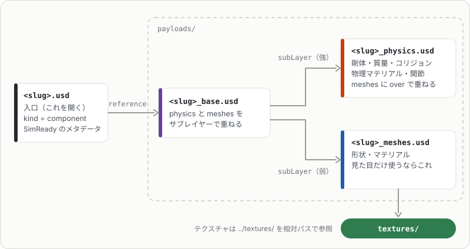
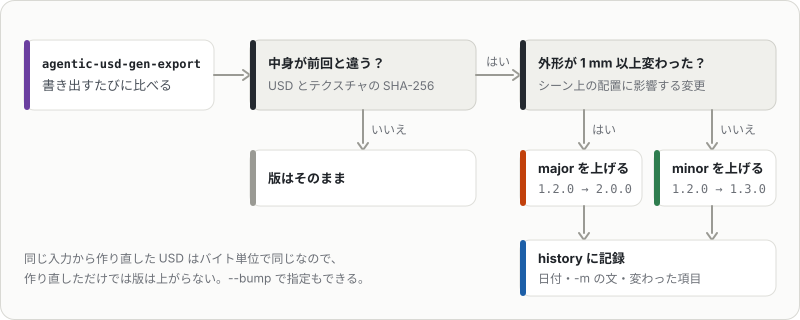

# リポジトリ管理用の書き出し

`out/`は作業用の出力です。リポジトリで管理するときは`agentic-usd-gen-export`で必要なものだけを書き出します。読むフォルダは`--out`（既定`out/`）、書き出し先は`--assets`（既定`assets/`）です。

```bash
uv run agentic-usd-gen-export                          # out/ にある、作ったときの検証が OK のアセットをすべて assets/ へ
uv run agentic-usd-gen-export --out out/fictional      # 架空の商品を out/fictional に作ったとき（--out は作ったときと同じフォルダ）
uv run agentic-usd-gen-export cup_noodle_tall --out out/fictional --recipes recipes   # slug を指定。検索キャッシュも recipes/ へ
uv run agentic-usd-gen-export cup_noodle_tall --out out/fictional -m "フタの色を修正"  # 更新履歴に変更内容を書く
```

書き出しでは、中身が同じテクスチャを1つのファイルにまとめ、USDの参照をそれに向けます（同じ商品を什器に並べると、部品ごとに同じ画像ができるため。有孔ボードの電池・電球売場`pegboard_batteries_bulbs`は、まとめる前の559 MBが51 MBになった）。asset.jsonが名前で参照する画面・掲示物の画像はまとめません。

```
assets/
  README.md                 一覧（サムネイル付き）
  catalog.json              全アセットのメタデータ
  catalog.usda              全アセットを並べて payload で読み込むステージ（見比べ用）
  <category>/<slug>/simready_usd/   SimReady の規約（NP.005: <アセット名>/<中間フォルダ>/<アセット名>.usd）
    <slug>.usd              入口。payloads/<slug>_base.usd を参照する（kind = component、SimReady のメタデータ）
    payloads/               Isaac Sim のレイヤー構成（SimReady の FET_100_ISAAC）
      <slug>_base.usd       physics と meshes をサブレイヤーで重ねる
      <slug>_meshes.usd     形状・マテリアル（テクスチャは ../textures/ を相対パスで参照）
      <slug>_physics.usd    剛体・質量・コリジョン・物理マテリアル・関節（over で重ねる）
    textures/
    thumbnail.png           512px 四方、背景透過
    .thumbs/256x256/<slug>.usd.png   Omniverse / Isaac Sim のブラウザ用（SimReady の規約）
    README.md               モデルカード（寸法・質量・物理・根拠 URL・制約・更新履歴・画像の出典）
    asset.json              機械可読のメタデータ（version・tags・description・front・content_hash・history）
recipes/<キャッシュ名>/      spec.json・vision.json・images/
```

USDは4つのレイヤーに分かれます。入口の`<slug>.usd`を開けば、分ける前と同じ内容になります。



- カテゴリ（`beverage` / `food` / `household` / `fixture` / `environment`）は`cache/<商品名>/spec.json`の`category`から取ります。未設定なら容量があれば`beverage`、なければ`uncategorized`です。
- レイヤーに分けるのは書き出し先だけです（`src/agentic_usd_gen/isaac_layout.py`）。`out/`の生成結果は1ファイルのままで、版の判定もこちらの中身で行います。
  物理を外して見た目だけ使うときは`payloads/<slug>_meshes.usd`を参照してください。
- サムネイルは`--preview`のときに`debug/thumbnail.png`として描画されます。なければ書き出し時に描画します。
- `recipes/`は`uv run agentic-usd-gen "<商品名>" --cache recipes`でそのまま再生成に使えます。

> [!WARNING]
> 書き出し先の`<slug>/`は毎回作り直します。手で編集したファイルは消えるので、置かないでください。

> [!CAUTION]
> `agentic-usd-gen <商品名>`で作ったアセットは、実在の商品の画像をテクスチャに含みます。画像の権利は元の権利者にあるので、書き出した`assets/`・`recipes/`を公開・再配布しないでください（置くリポジトリは非公開にします）。公開するアセットは`agentic-usd-gen-fictional`で作ります（[fictional.md](fictional.md)）。

## 以前の書き出しから移るとき

新しく書き出すだけなら、この節は要りません。

- 旧構成（`<category>/<slug>/`の直下にUSD）の書き出しがあれば、書き出すときに消して、版を引き継ぎます。
- 重複したテクスチャをまとめる前に書き出したアセットは、次のコマンドでまとめ直せます（いまの書き出しは、はじめからまとめます）。

    ```bash
    uv run agentic-usd-gen-dedupe-textures assets
    ```

## バージョン

各アセットは`1.0.0`から始まる版を持ち、`asset.json`の`version`、USDの`assetInfo.version`、モデルカードに書かれます。



- 書き出すたびに`out/`のUSDとテクスチャのSHA-256（`content_hash`）を前回の`asset.json`と比べ、変わったときだけ版を上げます。
  同じ入力からの再生成はバイト単位で同じUSDになるので、作り直しただけでは版は上がりません。
- 外形が1 mm以上変わったらmajor（シーン上の配置に影響する変更）、それ以外はminorを上げます。`--bump major|minor|patch`で指定もできます。
- 版を上げたときは`history`に日付と変更内容を記録します。`-m`の文に加えて、変わった項目（USD・テクスチャ・外形・質量・コリジョン・カテゴリ）を自動で書きます。
- 版の情報は書き出し先の`asset.json`から引き継ぐので、`assets/`は消さずにgitで管理してください。

## 検索用のメタデータ

書き出し先のUSDのルートPrimには、日本語名・カテゴリ・タグ・説明を書きます。

- `assetInfo`（`displayName`・`category`・`tags`・`description`、`version`）と、Primの`displayName`・`documentation`
- セマンティックラベル: 旧形式の`semantic:*:params:semanticType/semanticData`（`class` = カテゴリ、`tag` = 各タグ、`name` = 日本語名）と、
  `UsdSemantics.LabelsAPI`（`semantics:labels:class`・`semantics:labels:tag`）。Isaac SimのReplicatorのラベルとしても使えます。
- ルートレイヤーの`customLayerData`の`SimReady_Metadata`（SimReadyのSR.004）: `author`・`asset_name`（slug）・`asset_type`（`prop`）・
  `asset_license`（未指定なら`proprietary`）・`category`・`source_file`・`usd_date_generated`・`qcode`・`rigid_body_count`・`asset_extents`・`mass`。
  `qcode`は商品の種類を表すWikidataのQコードで、slugから引きます（`src/agentic_usd_gen/qcode.py`。どれにも当たらなければカテゴリの既定値）。
  `spec.json`に`qcode`を書けばそれを使います。`author`は`--author`で指定でき、省略時は前回の値か`pyproject.toml`のauthorsの名前です。

### 正面の向き

`asset.json`の`front`は商品・什器の正面の向きです（USDには正面の決まりがないため、配置するツール向けに書きます）。
agentic-usd-genの形はどれも正面（箱の正面・袋の表・回転体のラベルの正面、什器のお客さま側）が`-Y`なので、既定は`"-Y"`です。
寝かせた袋も、上から見て`-Y`側から表の画像が読める向きです。`spec.json`に`front`（`"+X"`・`"-X"`・`"+Y"`・`"-Y"`か、+Xから反時計回りの度数）を書けばそれを使います。
置き方に影響するので、`front`が変わったときは版のminorが上がります。

### タグ

タグはカテゴリ・形状・容器の材質（英語と日本語）に、`spec.json`の`tags`（ブランド・種類・味など）を足したものです。
飲料・食品には「中身 + 容器」の英語の句も足します（`green tea bottle`・`bottled green tea`・`canned coffee`・`strawberry jam jar`など）。
"green tea bottle" のような自然な英語の検索は、主名詞の容器がタグにないと当たらないためです。

中身は`tags`の最初の英語の語です。容器は次の順で決め、決まらないもの（袋のお菓子など）には付けません。

| 見るもの | 容器 |
|---|---|
| `tags`の容器の語 | `PET bottle` → bottle、`juice box` → box |
| 回転体の材質 | PET・ガラス → bottle（slugが`_jar`ならjar）、アルミ・スチール → can |
| slugの`bottle`・`pump` | 樹脂の回転体はカップやケースも多いので、この語があるときだけボトルとみなす（`mayonnaise bottle`）。日用品にも付ける（`shampoo_pump` → `shampoo bottle`） |
| slugの`bag`・`pouch`・`box`（最後のもの） | 袋・箱の食品（`potato_chips_bag` → `potato chips bag`、`curry_roux_box` → `curry roux box`） |

足りなければ`cache/<商品名>/spec.json`の`tags`に書き足して`agentic-usd-gen-export`し直します。作り直さずに反映されます（版はminorが上がります）。
[NVIDIA USD Search](https://github.com/NVIDIA-Omniverse/usd-search)で`assets/`だけを検索対象にする設定例は[usd-search.md](usd-search.md)にあります。

## マテリアル

マテリアルには素材の意味ラベル（`semantics:labels:material`。SimReadyのSL.MAT.001）を付けます。容器の材質や部品の`finish`・`material`から決まり、
物理マテリアルにはそのマテリアルを使う部品の素材が付きます。

描画するメッシュには表示色（`primvars:displayColor`。SimReadyのDISP.001〜003）も書きます。マテリアルを読まない簡易表示で使われる色で、
割り当てたマテリアルのテクスチャの平均（なければマテリアルの色）を線形の値で入れます。面ごとにマテリアルを分けたメッシュ（キャップの天面など）は
面ごとの色（`uniform`）、透明・半透明の部品は不透明度（`primvars:displayOpacity`）も書きます。

### センサー向けの属性

LiDAR・レーダーなどのセンサー用に、メッシュに割り当てた見た目のマテリアルへ光学以外の属性（SimReadyのFET_007）も書きます（`src/agentic_usd_gen/nonvisual.py`）。

| 属性 | 決め方 |
|---|---|
| `omni:simready:nonvisual:base` | 液体は`water`、PETは`plexiglass`、ガラスは`clear_glass`（半透明なら`frosted_glass`）。ほかは素材の意味ラベルから`aluminum`・`steel`・`paper`・`wood`・`plastic`など（食品は`skin`） |
| `omni:simready:nonvisual:coating` | 印刷面（ラベル・袋や箱の面・絵柄のある蓋）は`paint`、ほかは`none` |
| `omni:simready:nonvisual:attributes` | 透明・半透明の部品は`visually_transparent`、ほかは空 |

物理マテリアルと、面の組（GeomSubset）だけに割り当てたマテリアル（キャップの天面など）には書きません。SimReadyの検査は
GeomSubsetへの割り当てを数えないので、書くと「割り当てのないマテリアルに書いた」（NVM.004）になります。

### OpenPBR

MaterialXのOpenPBR Surface（SimReadyのFET_006_OPENPBR）も、見た目のマテリアルごとに`OpenPBR`（`ND_open_pbr_surface_surfaceshader`）
として書き、`outputs:mtlx:surface`に繋ぎます（`src/agentic_usd_gen/openpbr.py`）。値はMDLと同じものをOpenPBRの入力に置き換えます
（PET・ガラスは`transmission_weight` = 1、PETと半透明の部品は`geometry_thin_walled`、液体は`transmission_depth`にMDLと同じ深さ）。
テクスチャはMaterialXの`image`ノードで読み、色（ラベルの画像）は`srgb_texture`、粗さ・金属度・法線は`none`を
ファイルの属性の`colorSpace`に書きます（VM.TEX.004）。法線は`ND_normalmap_float`を通して`geometry_normal`に繋ぎます。
UsdPreviewSurfaceとMDLはそのまま残すので、使う側が対応する出力を選びます。Quick Look用のusdzには入れません。

### 粗さと金属度

容器・キャップ・ラベル（袋・箱の印刷面を含む）の粗さと金属度は、マテリアルの意味ラベルから素材を決めて表から引きます（`src/agentic_usd_gen/finish.py`）。

| 素材 | 当てはまるもの | roughness | metallic |
|---|---|---|---|
| `pp` | プラスチックのキャップ・蓋 | 0.55 | 0 |
| `film` | 袋・ラベルの印刷フィルム | 0.20 | 0 |
| `paper` | 紙パック・紙箱 | 0.65 | 0 |
| `plastic` | そのほかの成形品の容器 | 0.45 | 0 |
| `aluminum` / `steel` / `metal` | 缶 | 0.30 / 0.35 / 0.30 | 1 |
| `wood` / `food` | | 0.62 / 0.55 | 0 |

画像を貼る面では、この粗さを粗さマップの地の値にします（インクの部分はそこから少しずらします）。
`spec.json`の`surfaces`で、マテリアル名か素材名ごとに上書きできます。例: `"surfaces": {"CapMat": {"roughness": 0.4}, "paper": {"roughness": 0.7}}`。
透明・半透明・液体のマテリアルは対象外です。組み合わせの部品は`finish`で決まり、マテリアル名での上書きだけ受け付けます。

## 把持の線

ロボットがつかむ向きの目安として、把持の線（SimReadyのFET_005。GSP.001）も書きます（`src/agentic_usd_gen/grasp.py`）。
ルート直下の`grasp_identifier_01`（2点の`BasisCurves`）で、2点はハンドの指が当たる所です。高さの中ほどの断面
（メッシュの辺と水平面の交点）で幅の狭いほうの向き（xかy）に引くので、ボトル・缶・カップは直径、箱・袋・かごは短い辺を横切ります。
描画しない`guide`なので、プレビューにもQuick Look用のusdzにも出ません。床に固定する什器（`static`）には付けません。
線の2点と指の開き（`width`）は`meta.json`の`grasp`に書きます。

## 物理マテリアル

物理マテリアル（摩擦・反発係数）も、コリジョンの部品ごとに割り当てた見た目のマテリアルから素材を決めて表から引きます（`src/agentic_usd_gen/physics_material.py`）。
素材が同じ部品は1つの物理マテリアルを共有し、主な部品のものを`PhysicsMaterial`、ほかを`PhysicsMaterial_<素材>`とします。

| 素材 | static friction | dynamic friction | restitution |
|---|---|---|---|
| `aluminum` / `steel` / `metal`（缶） | 0.30 | 0.24 | 0.15 |
| `glass`（ガラス瓶） | 0.30 | 0.24 | 0.15 |
| `plastic`（PET・PP・HDPEの成形品） | 0.35 | 0.28 | 0.10 |
| `film`（袋） | 0.40 | 0.32 | 0.05 |
| `paper`（紙パック・紙箱） | 0.50 | 0.40 | 0.05 |
| `wood` | 0.45 | 0.36 | 0.10 |
| `food` | 0.50 | 0.40 | 0.05 |

静止摩擦は乾いた樹脂の指・棚板を相手にした概算（参考: [Engineering ToolBox](https://www.engineeringtoolbox.com/friction-coefficients-d_778.html)）、動摩擦は静止摩擦の0.8倍です。
相手の素材・表面の状態で大きく変わるので、実機に合わせるときは`spec.json`の`physics_materials`で素材名かコリジョンの部品名ごとに上書きします。
例: `"physics_materials": {"paper": {"static_friction": 0.6}, "Cap": {"restitution": 0.2}}`。
使った値は`meta.json`の`physics_materials`、`asset.json`の`physics.materials`、モデルカードの「物理」に書きます。

## コリジョンの近似

コリジョンの近似方法（`physics:approximation`）は既定で`convexHull`（凸包）です。カップのような開いた形や、へこみに意味のある什器の部品は、
`spec.json`の`collision_approximation`（コリジョンの部品名 → 方法）か、組み合わせの部品の`collision_approximation`で変えます。
例: `"collision_approximation": {"Body": "convexDecomposition"}`。
花形の底（`dimensions.lobes`）のボトルは、指定がなければ本体を`convexDecomposition`にします。
PhysXは凸包の面の数を抑えるため、底の脚先が1点に潰れ、立てても倒れるからです（`agentic-usd-gen-droptest`で確かめました）。

| 方法 | 向いているもの |
|---|---|
| `convexHull` | 閉じた容器・箱・袋（既定） |
| `convexDecomposition` | 開いた形・へこみのある形（いくつかの凸形に分ける。動く剛体でも使える） |
| `meshSimplification` | 床に固定する什器（`static`）の複雑な形。動く剛体ではPhysXが凸包に置き換えるので、検証で警告する |
| `boundingCube` / `boundingSphere` | 形を気にしない、軽いコリジョン |

部品ごとの方法は`asset.json`の`physics.collision_approximations`とモデルカードの「物理」に書きます（すべて`convexHull`なら省きます）。

## MuJoCo・Newton

物理はUsdPhysicsで書き（PhysX・Isaac Simはそのまま読む）、MuJoCo・Newton向けのスキーマも付けます（SimReadyのFET_003。`src/agentic_usd_gen/physics_runtimes.py`）。

| シミュレータ | 付けるスキーマ |
|---|---|
| MuJoCo | コリジョンに`MjcCollisionAPI`。MuJoCoはメッシュを凸包でしか扱えないので、`convexHull`以外のメッシュには付けず、検証で警告する |
| Newton | コリジョンに`NewtonCollisionAPI`、メッシュなら`NewtonMeshCollisionAPI`（SDFは使わない）。物理マテリアルに`NewtonMaterialAPI` |

どれもスキーマを付けるだけで値は書かず、摩擦などはUsdPhysicsの値、それ以外は各シミュレータの既定になります。
