# 架空の商品

実在の商品名・ブランド名・ロゴ・商品写真を使わないアセットを作ります。公開リポジトリに置く用途を想定しています。
565点を定義しています（`src/agentic_usd_gen/fictional/`の下。slugの一覧は`agentic-usd-gen-fictional --list`）。

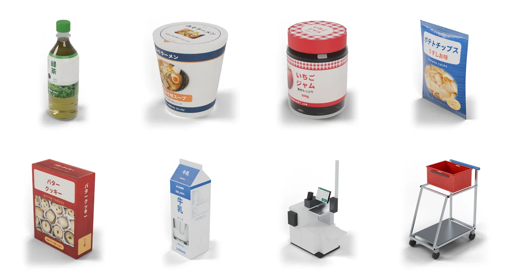

| 分野 | ファイル | 点数 | 主なもの |
|---|---|---|---|
| 基本の商品と什器 | `products.py` | 38 | 飲料・食品・カップめん・袋菓子・日用品、ゴンドラ・レジ・セルフレジ・サイネージ |
| 食品 | `food_pantry.py`・`food_fresh_snack.py`・`shelf_more.py` | 47 | 調味料・缶詰・レトルト・米・日配品・菓子・冷凍食品・酒 |
| 日用品 | `household_cleaning.py`・`household_personal.py`・`goods_more.py` | 35 | 洗剤・掃除用品・紙製品・ヘアケア・オーラルケア・レジまわりの小物 |
| コンビニの商品 | `conv_drinks.py`・`conv_food.py`・`conv_goods.py`・`conv_sweets.py`・`conv_deli.py`・`conv_snacks.py`・`drinks_large.py`・`drinks_more.py` | 74 | 飲料・中食・チルドスイーツ・ホットスナック・冷凍食品・菓子・雑貨 |
| コンビニの什器・設備 | `store_equipment.py`・`store_floor.py`・`store_counter.py`・`store_more.py` | 23 | 監視カメラ・ATM・リーチイン冷蔵ケース・保温ケース・たばこ棚・吊り下げフック什器 |
| スーパー | `super_produce.py`・`super_fresh.py`・`super_fixtures.py`・`super_checkout.py` | 41 | 青果・精肉や鮮魚のトレーパック・惣菜、売場の什器、レジ台・サッカー台 |
| ドラッグストア | `drug_fixtures.py`・`drug_medicine.py`・`drug_cosmetics.py`・`drug_baby.py` | 27 | 医薬品・化粧品・ベビー用品、調剤カウンター・テスター什器 |
| ホームセンター・100円ショップ | `hc_tools.py`・`hc_garden.py`・`hc_daily.py`・`hc_fixtures.py` | 39 | 工具・金物・園芸用品・収納・長尺物、高層ラック・パレット・有孔ボードのゴンドラ |
| 書店 | `book_fixtures.py`・`book_goods.py` | 10 | 本棚・平台、単行本・文庫・新書 |
| 家電量販店 | `elec_fixtures.py`・`elec_goods.py` | 16 | 展示台・ショーケース、家電の箱・ブリスターパック |
| 衣料品店 | `apparel_fixtures.py`・`apparel_goods.py` | 16 | ハンガーラック・陳列台・マネキン・試着室、たたんだ服・靴箱 |
| カフェ・パン屋 | `cafe.py`・`bakery.py` | 18 | 注文カウンター・エスプレッソマシン・テーブルと椅子、パンの陳列棚・パン |
| 飲食店 | `restaurant_dining.py`・`restaurant_equipment.py`・`restaurant_food.py`・`restaurant_kitchen.py`・`restaurant_tableware.py` | 48 | 客席の家具・配膳の備品・皿に盛った料理・業務用厨房機器・食器 |
| 専門店・そのほかの店 | `specialty_shops.py`・`store_kinds.py`・`misc_shops.py` | 69 | 自転車店・和菓子店・レコード店・スポーツ用品店・家具店・花屋・おもちゃ屋・ペットショップ・靴屋・眼鏡店・酒屋など |
| バックヤード・物流 | `backyard.py` | 13 | カゴ台車・番重・折りたたみコンテナ・段ボール箱・ハンドリフト・スチールラック |
| 内装・建具 | `store_env.py`・`interior.py`・`windows.py` | 47 | 床・壁・天井・照明・掲示物・ドア・トイレ・間仕切り・窓・カーテン |
| 植物工場 | `farm.py` | 4 | イチゴの栽培ラック・ポット苗・AGVの誘導テープ |

## 見本

分野ごとに、作ったアセットを並べて描画したものです。

| スーパー | ドラッグストア |
|---|---|
| 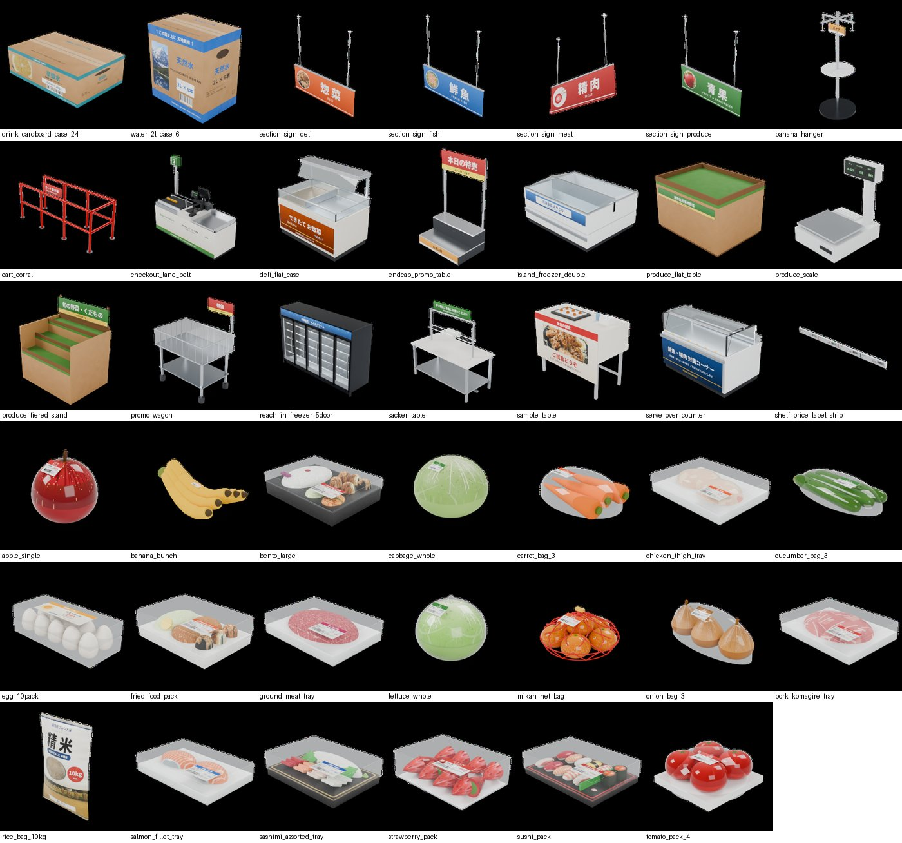 | 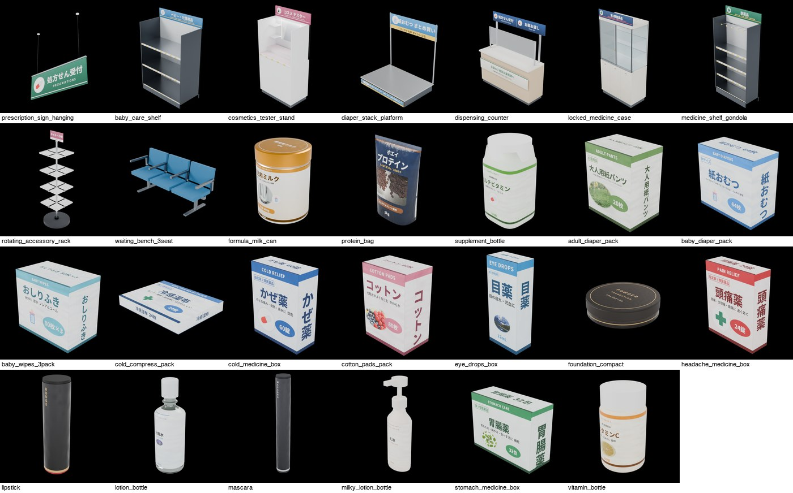 |
| **ホームセンター・100円ショップ** | **書店・家電量販店・衣料品店** |
| 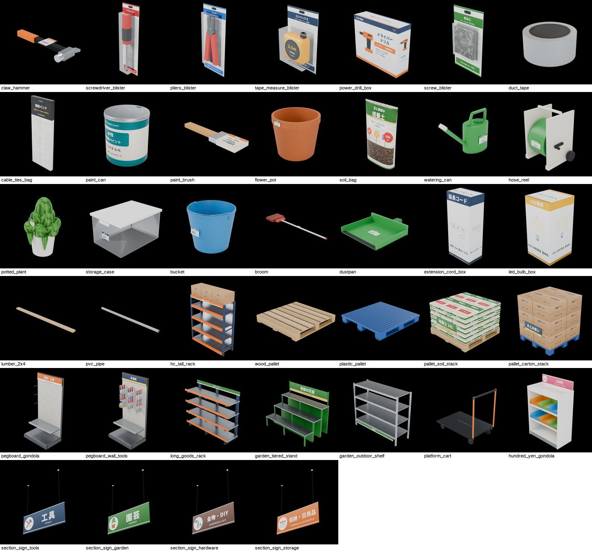 | 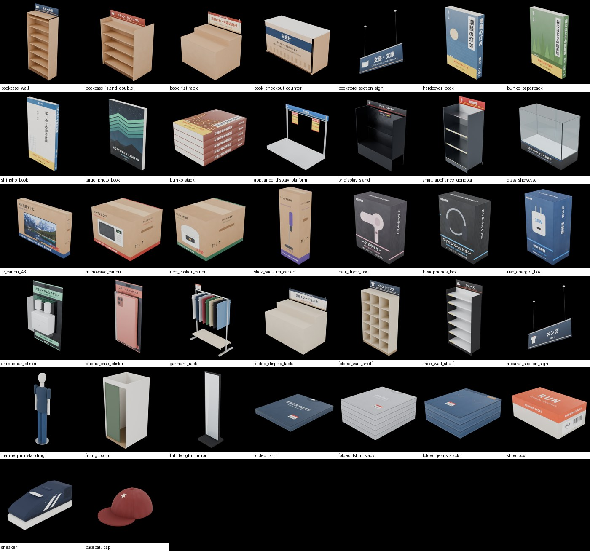 |
| **飲食店** | **カフェ・パン屋** |
| 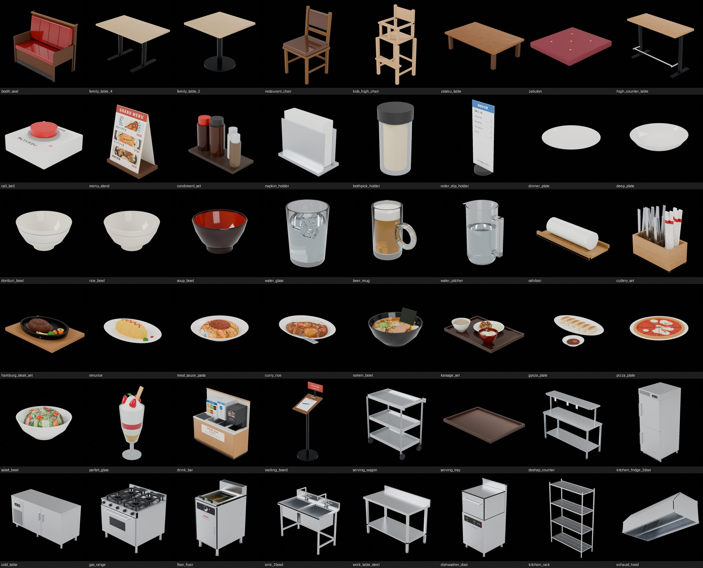 | 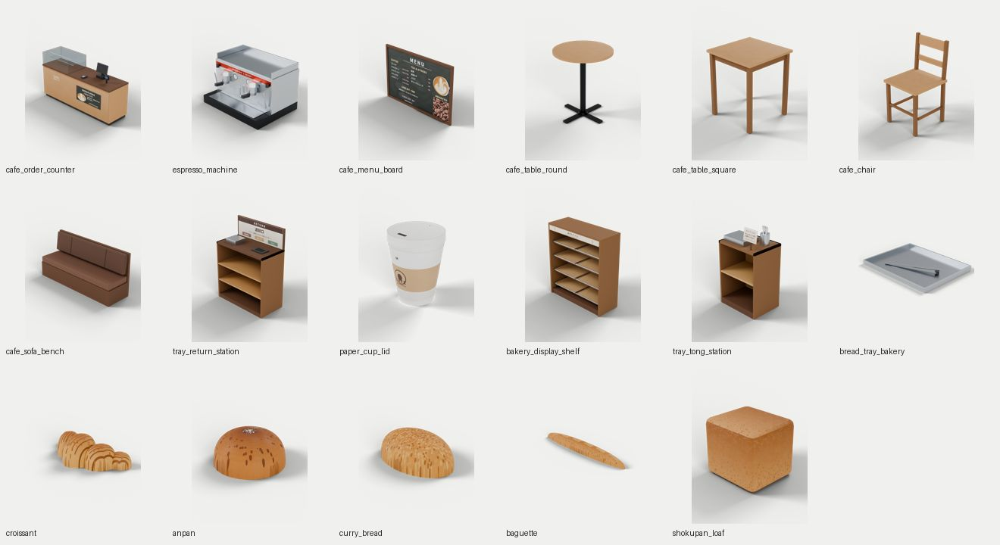 |
| **バックヤード・物流** | **内装・建具** |
| 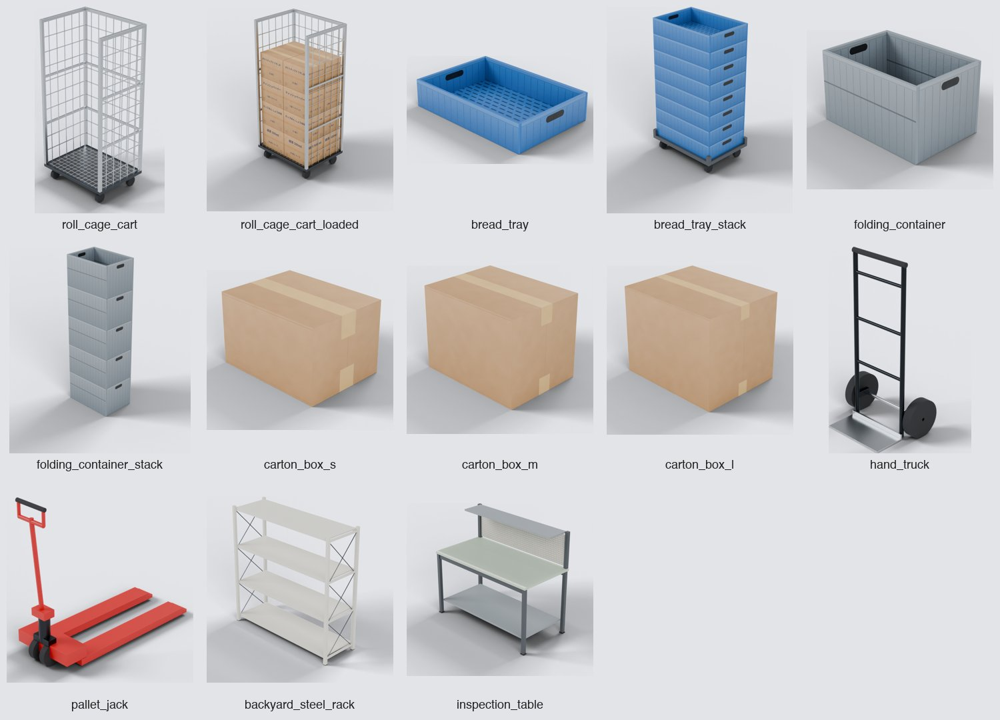 | 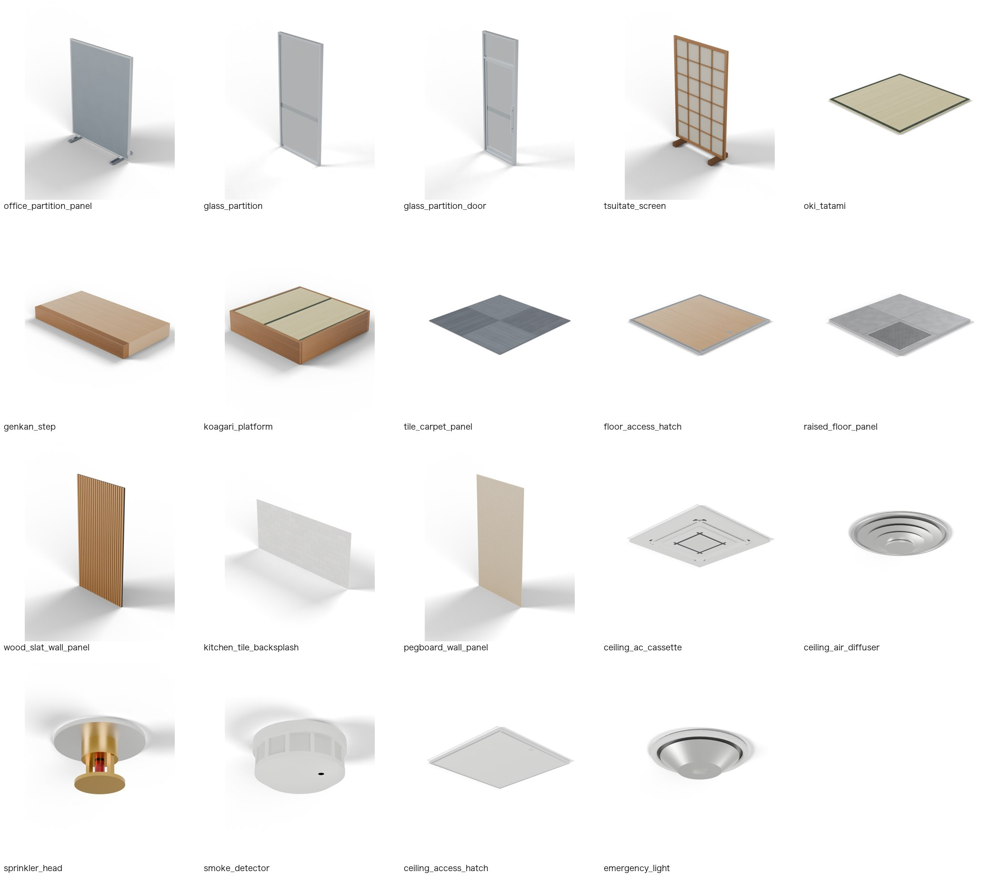 |
| **窓** | **植物工場** |
| 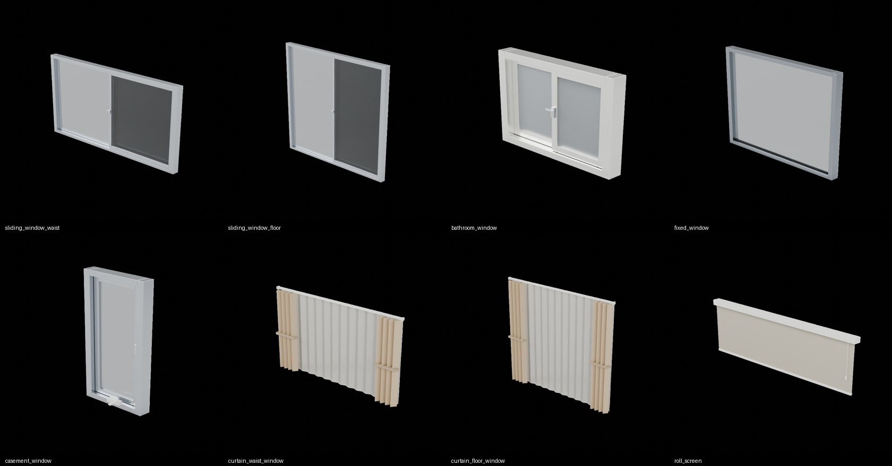 | 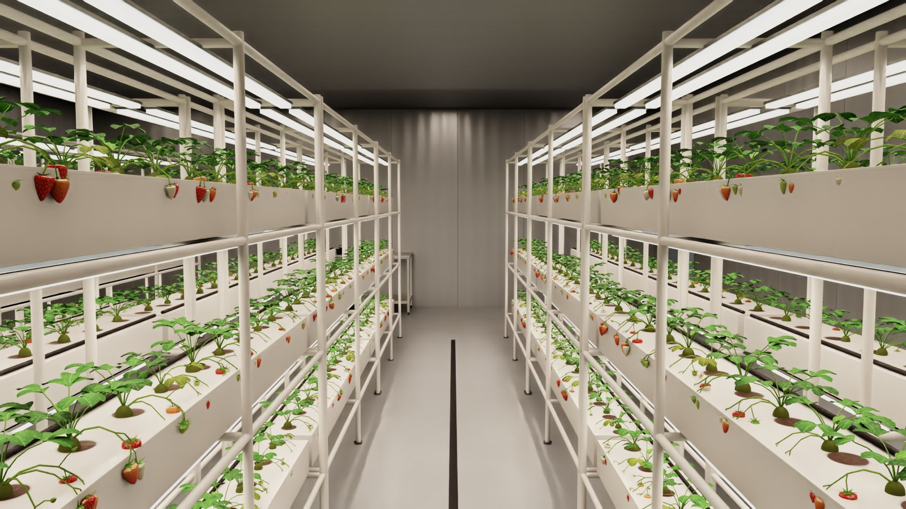 |

## 作る

検索の代わりに絵柄を自分で描いてキャッシュに書き、そのあとは検索して作るときと同じ処理でUSDにします。

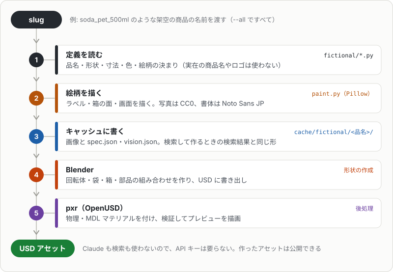

```bash
uv run agentic-usd-gen-fictional --all --out out/fictional --preview        # 全点
uv run agentic-usd-gen-fictional cup_noodle_tall soda_pet_500ml --no-build  # 画像と spec.json だけを cache/fictional/ に書き、USD は作らない（絵柄だけ確かめるとき）
uv run agentic-usd-gen-export cup_noodle_tall --out out/fictional --assets <公開用リポジトリ>/assets -m "初版"
```

`cache/fictional/<商品名>/`に画像（回転体は`00.png`シルエット・`01.png`全周ラベル・`02.png`上面）と`spec.json`・`vision.json`を書いてから、通常の生成を実行します。`agentic-usd-gen`のオプション（`--preview`・`--usdz`など）はそのまま渡せます。

`vision.json`の`faces`に`"side": N`を書くと、回転体のラベルに展開済みの全周画像（横 = 円周、横幅の75% の位置が正面）をそのまま貼ります。

### slugの一覧

slugを調べるには`--list`を使います。slug・分類・形状・品名を1行ずつ出して終わります（何も作りません）。後ろに語を並べると、すべての語を含む行だけになります。

```console
$ uv run agentic-usd-gen-fictional --list pouch food
potato_chips_bag       food       pouch  ポテトチップス うすしお味 60g
chocolate_bar          food       pouch  チョコレートバー ココアクッキー
...
```

一覧は`src/agentic_usd_gen/data/fictional_index.tsv`に置いています（品名は定義を呼ばないと分からず、呼ぶと絵柄まで描くため）。商品を足したり品名を変えたりしたら、`uv run python -m agentic_usd_gen.fictional.listing`で作り直します（数分かかります）。

## 物理の扱い

- 商品・台車・テーブル・椅子・パレットなどは動く剛体、床置きの什器・内装は動かない物（`static`）です。台車の車輪は回りません（関節なし）。
- 什器に掛けた・積んだ商品（フックの袋、ハンガーラックの服、台車の段ボールなど）は、什器の固定の部品です。フックや金網の細い線は見た目だけで、当たり判定はありません（PhysXで細い棒に物を掛けると安定しないため）。
- 扉・引き戸・回転ラックなどは関節で動きます（[関節](shapes.md#関節)）。

## 名前と見た目の決まり

- **名前:** 一般的な名前（種類・味・容量）だけで、ブランド名は付けません（例:「カップめん みそ味」「緑茶600ml」）。
- **形と寸法:** 特定の商品ではなく、同じ種類の商品の一般的な代表値です。回転体は`fictional/forms.py`のプロファイル（PETボトル・缶・紙カップ・エアゾール缶など）から側面のシルエットを描き、通常の生成で形にします。
- **見た目:** `fictional/paint.py`で、パブリックドメイン（CC0など）の写真を合成し、細かい文字（一括表示・栄養成分表示）・ダミーのバーコード（先頭2のインストアコード範囲）・識別表示マーク・紙／フィルム／金属の質感を描きます。
  描く画素密度は面の実寸から決め、貼ったテクスチャが8 px/mm以上になるようにします（長い辺が4096 pxを超える大きな面を除く）。
- **素材:** 写真は`src/agentic_usd_gen/data/photos/`（出典とライセンスは`photos.json`）、書体はNoto Sans JP（SIL Open Font License 1.1、`src/agentic_usd_gen/data/fonts/`）。使った素材は`spec.json`の`image_credits`に入り、`agentic-usd-gen-export`のモデルカード（README.md）と`asset.json`に出典として書き出されます。
- 店の絵柄・文面のある面は`Picture`バリアントで無地に、画面は`Screen`バリアントで消せます。
- 家電量販店は、家電そのもの（テレビ・電子レンジなど）は作らず、箱と什器だけです（本体はSimReady Centralのものを使う想定）。
