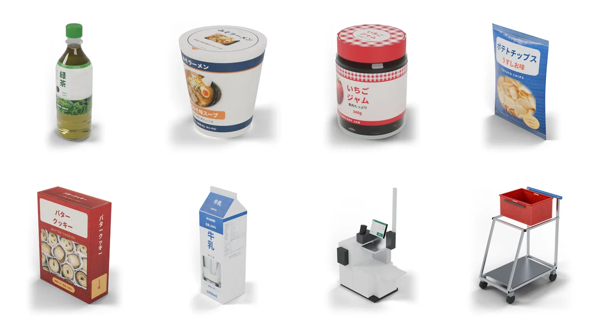
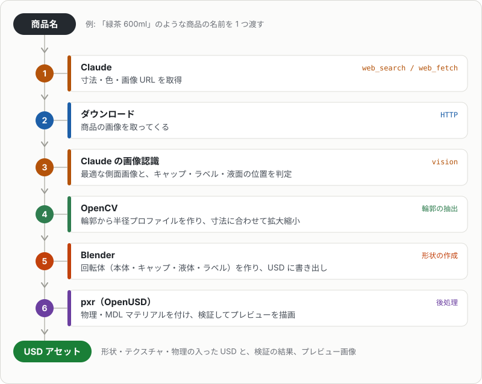
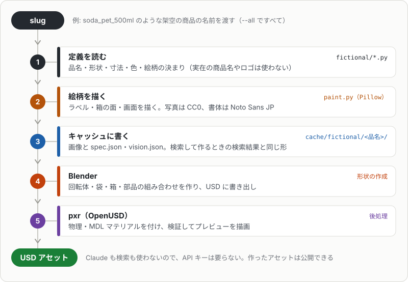
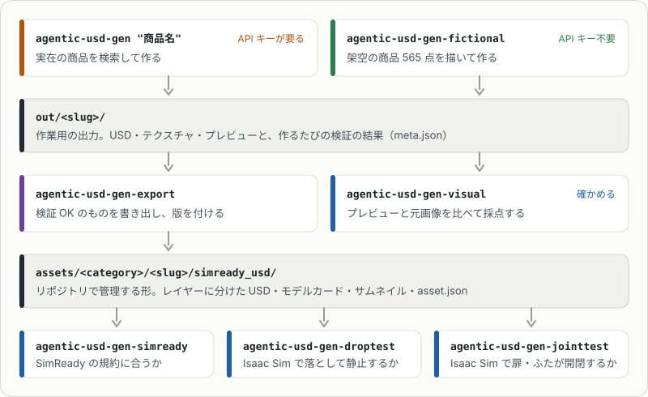

# agentic-usd-gen

商品名を渡すと、AIエージェント（Claude）が自分でWebを検索して寸法と画像を調べ、Blenderで3Dモデルを作ってIsaac Sim向けのUSDを書き出すツールです。

エージェントが受け持つのは「調べる」部分です。

- Claudeが検索（`web_search`）とページの取得（`web_fetch`）のツールを使い、何を検索するか・どのページを開くかを自分で決めながら、寸法・形状・色・商品画像のURLを集めます。人が検索語やURLを渡す必要はありません。
- 集めた画像のうち、形を取るのに使う1枚と、キャップ・ラベル・液面の位置も、Claudeが画像を見て決めます。

そのあとは決まった処理です。Blenderが形を作り、OpenUSD（`pxr`）が物理とマテリアルを付けて検証します。架空の商品（`agentic-usd-gen-fictional`）はエージェントを使わず、定義から描いて同じ処理で作ります。



`agentic-usd-gen-fictional`で作った架空の商品の例です（大きさはそろえて並べています）。

> [!IMPORTANT]
> NVIDIAの公式のものではありません。Isaac Sim・Omniverse・SimReadyはNVIDIA Corporationの商標です。

## 2つの作り方

作り方は2つあり、それぞれ別のコマンドです。

| コマンド | 何をするか | APIキー | 作ったアセットの公開 |
|---|---|---|---|
| `agentic-usd-gen <商品名>` | 実在の商品を検索し、商品ページの画像をテクスチャにして作る | 要る | できない |
| `agentic-usd-gen-fictional` | [架空の商品](fictional.md) 565点（商品・什器・内装）を、実在の商品名・ロゴ・商品写真を使わずに描いて作る | 要らない | できる |

> [!CAUTION]
> `agentic-usd-gen <商品名>`で作ったアセットは、実在の商品の画像を含みます。画像の権利は元の権利者にあるので、そのアセット（テクスチャ・USD）を公開・再配布しないでください。公開するアセットは`agentic-usd-gen-fictional`で作ります。

`<商品名>`には検索したい商品の名前を入れます。名前に空白があるときは、シェルが1つの引数として渡すように引用符で囲みます（例: `agentic-usd-gen "緑茶 600ml PET"`）。空白がなければ引用符は要りません。

`agentic-usd-gen <商品名>`の処理の流れ（回転体の場合）:



`agentic-usd-gen-fictional`の処理の流れ:



## 試す

[uv](https://docs.astral.sh/uv/)とBlender 4.xが要ります。架空の商品ならAPIキーは要りません。Isaac Simがなくても作れます。

次は、架空の商品を1点（炭酸飲料のペットボトル`soda_pet_500ml`）作る例です。

```sh
git clone https://github.com/atinfinity/agentic-usd-gen.git && cd agentic-usd-gen
uv sync
uv run agentic-usd-gen-fictional soda_pet_500ml --out out/fictional --preview
```

- `soda_pet_500ml`は作る商品の名前（slug）です。ほかのslugに替えたり、空白で区切っていくつも並べたりできます（例: `cup_noodle_tall potato_chips_bag`）。`--all`を付けると565点すべてを作ります。
- 指定できるslugは`uv run agentic-usd-gen-fictional --list`で、分類・形状・品名と一緒に一覧できます（何も作りません）。後ろに語を並べると絞り込めます（例: `--list pouch food`）。分野ごとのまとめは[架空の商品](fictional.md)にあります。
- `--out`は出力先のフォルダ、`--preview`はプレビュー画像も描く指定です。できたUSDは`out/fictional/soda_pet_500ml/`に入ります。

準備（Blenderの場所、APIキー）とオプションの説明は[準備と使い方](usage.md)に、言葉の意味は[用語](glossary.md)にあります。

## 作ってから確かめるまで

Isaac Simは、作る・書き出す・SimReadyの検証には要りません（Macでも動きます）。要るのは、任意の確認である落下テスト（`agentic-usd-gen-droptest`）と関節の開閉テスト（`agentic-usd-gen-jointtest`）だけです。



| ページ | 内容 |
|---|---|
| [準備と使い方](usage.md) | 入れ方、APIキーが要る場合、コマンドのオプション |
| [形状とspec.json](shapes.md) | 回転体・袋・箱・部品の組み合わせの作り方と、`spec.json`に書ける項目（関節・照明・バリアントなど） |
| [架空の商品](fictional.md) | 公開できるアセットの一覧と作り方 |
| [出力](output.md) | `out/<slug>/`の中身、USDの内容、透明・半透明の部品（深度センサー向け） |
| [リポジトリ管理用の書き出し](export.md) | `agentic-usd-gen-export`、レイヤー構成、バージョン、メタデータ・マテリアル・物理マテリアル |
| [検証](validation.md) | SimReady・見た目の検証と、Isaac Simを使う任意の確認（落下テスト・関節の開閉テスト） |
| [プレビュー](preview.md) | macOS・Windows・Ubuntuでの確認のしかたと、MDL・MaterialXの想定内のエラー |
| [USD Search](usd-search.md) | NVIDIA USD Searchで`assets/`を検索する設定例 |
| [ソースの構成](structure.md) | ファイルごとの役割 |
| [用語](glossary.md) | slug・`spec.json`・キャッシュ・SimReadyなどの言葉の意味 |

## ライセンス

コードは[Apache License 2.0](https://github.com/atinfinity/agentic-usd-gen/blob/main/LICENSE)です。同梱している書体・写真は、それぞれのライセンスに従います（[NOTICE](https://github.com/atinfinity/agentic-usd-gen/blob/main/NOTICE)）。
