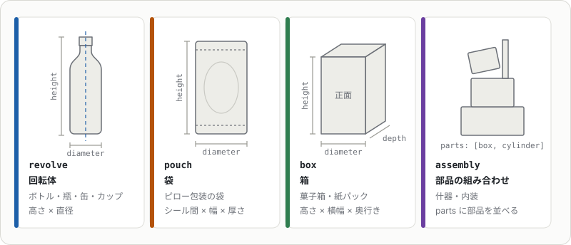
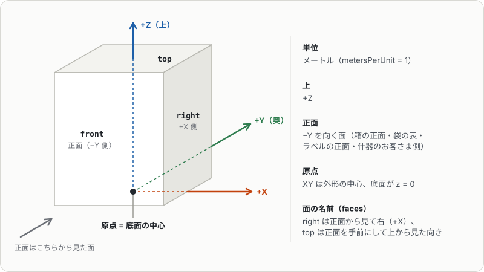

# 形状とspec.json

形状（`shape_class`）ごとの作り方と、`spec.json`・`vision.json`に書ける項目です。

`spec.json`は、作る物の寸法・形状・色などを書いたファイルです。商品名から作るときはClaudeが検索した結果が、架空の商品では定義から書いた内容が入り、`cache/<商品名>/`に置かれます（[spec.jsonと検索キャッシュ](#specjsonと検索キャッシュ)）。形を直したいときは、このファイルを編集して作り直します。

形状は次の4つです。寸法（`dimensions`）の意味は形状ごとに違います。



座標の決まりは、どの形状も同じです。



## spec.jsonと検索キャッシュ

検索結果と画像は`cache/<商品名>/`に保存され、2回目以降は再利用されます。
キャップとラベル地の色は`spec.json`の値を優先し、未設定のときだけ画像から推定します。
ただし回転体でラベルを商品画像から作るときは、キャップの色が画像とはっきり違えば画像の色に合わせます。ラベルの、画像に写っていない側は、高さごとに、写っている範囲の色で塗ります。
寸法が誤っていたときは、`cache/<商品名>/spec.json`を直接編集するか`--dims`で上書きしてください。

`cache/<商品名>/`の中身は次のとおりです（架空の商品は`cache/fictional/<品名>/`）。

| ファイル | 内容 |
|---|---|
| `spec.json` | 寸法・形状・色・質量・タグなど（下の表） |
| `vision.json` | 使う画像（`best_index`）、キャップ・ラベル・液面の位置（`landmarks`）、面に貼る画像の番号（`faces`） |
| `images/NN.png` | 画像。`faces`や部品の`faces`の番号は、この`NN` |

`spec.json`の例です（架空の商品`soda_pet_500ml`。出典などは省略）。

```json
{
  "product_name": "レモンソーダ 500ml",
  "slug": "soda_pet_500ml",
  "shape_class": "revolve",
  "dimensions": {"height": 0.215, "diameter": 0.066, "cap_height": 0.019, "cap_diameter": 0.0296, "depth": null},
  "capacity_ml": 500,
  "mass_kg": 0.53,
  "container_material": "PET",
  "orientation": "upright",
  "category": "beverage",
  "colors": {"cap": "#F4C531", "liquid": null, "label_base": "#FFF7D6"},
  "parts": [],
  "static": false,
  "tags": ["炭酸飲料", "レモン", "ソーダ", "ペットボトル", "soda", "lemon", "PET bottle"]
}
```

上位の項目は次のとおりです。長さはメートル、質量はkgです。

| 項目 | 内容 |
|---|---|
| `product_name` | 品名。キャッシュのフォルダ名にもなる |
| `slug` | 出力のフォルダ名とルートPrimの名前（英数字と`_`） |
| `shape_class` | 形状。`revolve` / `pouch` / `box` / `assembly` |
| `dimensions` | 外形の寸法。`height`・`diameter`・`depth`の意味は形状ごとに違う（上の図）。回転体は`cap_height`・`cap_diameter`・`square`・`lobes`、袋は`gusset`・`square`も書ける |
| `capacity_ml` | 内容量（ml）。中身の量と重心の計算に使う |
| `mass_kg` | 中身込みの総質量 |
| `container_material` | 容器の素材（`PET`・`glass`・`paper`など）。透け方と物理マテリアルを決める |
| `transparency` | 回転体の容器の透け方（[透け方](#透け方)）。未設定なら`container_material`から推定 |
| `orientation` | 袋の置き方。`upright`（立てる）か`lying`（寝かせる） |
| `category` | 書き出し先の分類。`beverage` / `food` / `household` / `fixture` / `environment` |
| `colors` | `cap`（キャップ）・`liquid`（中身。`null`は無色透明）・`label_base`（ラベル地）の色と、`liquid_turbidity`（中身の濁り） |
| `tags` | 検索用の語（[タグ](export.md#タグ)） |
| `parts` | 部品（[部品の組み合わせ](#部品の組み合わせassembly)）。回転体・袋・箱では本体に足す部品 |
| `bevel` | 箱の角の面取りの幅 |
| `static`・`mount` | 動かない什器にするか、天井付けか（[据え置きと取り付け](#据え置きと取り付け)） |
| `joints`・`lights`・`variant_sets` | 組み合わせの[関節](#関節)・[照明](#照明)・[バリアント](#バリアント) |
| `surfaces` | 表面のつやの上書き（[粗さと金属度](export.md#粗さと金属度)） |
| `physics_materials` | 摩擦・反発の上書き（[物理マテリアル](export.md#物理マテリアル)） |
| `notes`・`sources`・`image_candidates`・`image_credits` | 根拠のメモ、出典、画像の候補、テクスチャに使った素材の出典 |
| `fictional` | 架空の商品なら`true` |

## 回転体（revolve）

`dimensions.depth`を胴の直径より小さくすると、胴・中身・ラベルの断面が奥行き方向に縮んだ楕円になります（食器用洗剤のような平たいボトル。キャップは丸のまま）。ラベルの正面と裏面のパネルが平らな広い面に来ます。

`dimensions.square`を書くと、胴・中身・ラベルの断面が角の丸い四角になります（超楕円の指数。2で円、5前後で2Lの角形ボトル）。首に向かって丸に戻り、キャップは丸のままです。`diameter`は四角の一辺の幅になります。
`dimensions.lobes`に`[脚の数, 高さ, くぼみの深さ（半径比）]`を書くと、底から高さまでを脚の間でくぼませた炭酸ボトルの花形の底（ペタロイド）になります。

回転体には、形から判断して細部を足します（`shapes/details.py`）。

- **ねじキャップ**（金属でない容器の、胴よりはっきり細く高さ8〜35 mmのキャップ）: 側面に縦の溝（ローレット、間隔0.8 mm）を法線マップ`cap_normal.png`で付けます。上面は溝のない`CapTopMat`になります。
- **缶**（金属の容器の、低く太い巻き締めの縁）: 上面を縁の内側で6.3 mmくぼませ、底の中央を胴の直径の15% だけドーム状に持ち上げます。

どちらも外形（凸包）の内側に収まる形か法線マップなので、コリジョンと質量・重心は変わりません。PETの胴のリブ・くびれはプロファイル（シルエット）の凹凸として作ります。

キャップ・蓋は`colors.cap`の単色です。カップ麺の蓋のように上面に絵柄があるときは、真上から撮った蓋の画像を`vision.json`の`faces`で指定すると、上面の円にだけ貼ります（例: `"faces": {"top": 2}`）。
画像は背景を切り抜いて蓋の円に合わせるので、蓋がちょうど収まる正方形にしておきます（画像の下側が正面）。斜め俯瞰の写真しかなければ、蓋の楕円を縦に引き伸ばして円にしたものでも使えます。

### 透け方

回転体は容器の透け方（透明 / 半透明 / 不透明）で作り分けます。`spec.json`の`transparency`
（`transparent` / `frosted` / `translucent` / `opaque`）で明示でき、未設定なら`container_material`から推定します
（`不透明`・`opaque` → 不透明、半透明の語 → 半透明、透明の語 → 透明、それ以外 → 不透明の順。商品の検索ではLLMが`transparency`も埋めます）。
袋・箱・組み合わせには効きません（組み合わせは部品の`finish`で指定します）。

部品の名前（`Body`・`Liquid`・`Label`・`LabelBack`・`Cap`）と位置は、[出力の図](output.md#usdの内容)にあります。

- 透明（`PET`・`clear`・`透明`、PS・OPS・PC・アクリルの透明カップやケース。`container_material`が未設定のときも）: 透明な本体（肉厚0.4 mm）＋液体
- ガラス（`glass`・`ガラス`・`瓶`）: 透明なガラス瓶（屈折率1.52、ごく薄い緑の色味、肉厚3 mm・底7 mm）＋中身。質量が不明なら瓶の重さ（表面積 × 肉厚 × 密度2.5 g/cm³）を足す
- 半透明（`HDPE`・`polyethylene`・`半透明`・`translucent`、すりガラスは`frosted`）: 白く濁った半透明の本体＋液体。中身がうっすら透けて見える
- 中身の濁りは`colors.liquid_turbidity`（0 = 澄んでいる〜1 = ほぼ不透明）。未設定なら商品名・タグから推定する（オレンジ・混濁果汁0.7、牛乳・ミルクティー・ラテ0.95、スポーツドリンク0.25、炭酸・お茶・水0）
- 紙・アルミなど: 不透明な本体で、液体は作らない。中身は蓋の下端まで詰まっているとみなして重心を計算
- 透明・半透明の容器のラベルには裏面（`LabelBack`・`LabelBackMat`）を付ける。容器の表面とラベルの間に内向きの面を置き、
    白地に表の絵柄を15% だけ重ねた`textures/label_back.png`を貼る。容器越しに反対側のラベルの内側を見ても、表の絵柄が鏡写しで見えない

## 袋（pouch）

袋（`pouch`）は、平らな袋の縦 × 横（フィルム寸法）と膨らんだときの厚さから形を作ります。
上下のシールは平らで、中央ほど厚くなります。断面は表裏2枚の円弧で、フィルムの長さを保ったまま膨らむため、中央の見かけの幅と全高はフィルム寸法より少し小さくなります。
正面の画像を表に貼り、裏面にも同じ画像を使います。
裏面に別の画像を貼るときは`faces`で指定します（例: `"faces": {"front": 0, "back": 1}`）。裏面の画像は表と同じ縦横比で、立てた袋は後ろから見た向き、寝かせた袋は表と同じ横長の向き（長い辺を軸に裏返すと読める向き）にします。
チョコバーのようにシールが左右にある横長の袋は、`orientation`を`lying`にすると正面を上にして寝かせた向きで書き出します。
このとき画像はシールが左右にある横長の向きのまま使います（`height`はシール間の長さのまま）。
米袋のように底マチで自立する袋は、`dimensions.gusset`に底の厚さ（メートル、`depth`以下）を書くと、底を平らな面で閉じ、上端だけをシールにします（底の色は画像の下端の色）。
マチのない袋は底がシールの線なので、倒れ始める角度が0° で、少し傾けて置くと倒れます。
`dimensions.square`（超楕円の指数）を書くと、袋の断面も円弧のレンズ形ではなく角の丸い四角になります（フィルムの幅は断面の周の半分のまま）。

## 箱（box）

箱（`box`）は、高さ × 正面の横幅（`diameter`）× 奥行き（`depth`）の直方体です。正面（-Y）には、画像認識で選んだ1枚（`vision.json`の`best_index`）を貼ります。
他の面の画像は`vision.json`の`faces`で指定できます（例: `"faces": {"front": 0, "right": 1, "top": 2}`）。
`right`は正面から見て右側の面（+X）、`top`は正面側を手前にして上から見た向きの画像です。
画像の背景は自動で切り抜き、画像のない面はラベル地の色（`colors.label_base`、なければ正面画像の縁の色）で塗ります。
角は丸く面取りします（見た目だけで、外形の寸法は変わりません）。幅は`spec.json`の`bevel` [m] で変えられ、既定は0.8 mm、`0`で面取りしません。

## 部品の組み合わせ（assembly）

部品の組み合わせ（`assembly`）は、`spec.json`の`parts`に並べた部品をそれぞれ別のメッシュにします。
`dimensions`は全体の外形（`height` = 全高、`diameter` = 正面の横幅、`depth` = 奥行き）です。

```json
"static": true,
"parts": [
  {"name": "Base", "shape": "box", "size": [0.40, 0.30, 0.05], "center": [0, 0, 0.025],
   "rotation": [0, 0, 0], "color": "#333333", "finish": "metal", "faces": null, "collision": true},
  {"name": "Screen", "shape": "box", "size": [0.32, 0.02, 0.18], "center": [0, 0, 1.1],
   "rotation": [-15, 0, 0], "color": "#111111", "finish": "screen", "faces": {"front": 0}, "collision": true}
]
```

### 部品の項目

- 座標はメートル、Zが上、正面は -Y。全体はXYの中心が原点、底面がz=0になるよう自動で平行移動します。
- `shape`は部品の形です。

    | `shape` | 形 | `size` |
    |---|---|---|
    | `box` | 直方体 | 幅 × 奥行き × 高さ |
    | `cylinder` | 円柱（軸はZ） | Xの直径 × Yの直径 × 高さ |
    | `dome` | 底が平らな半楕円体 | `cylinder`と同じ |
    | `pointed_dome` | 先のとがった山（クリームの絞り・いちごなど） | `cylinder`と同じ |
    | `bun` | 肩の張ったまんじゅう形（中華まん・丸パンなど） | `cylinder`と同じ |
    | `revolve` | `profile`の断面をZ軸まわりに回した形 | `cylinder`と同じ |
    | `torus` | XY面に寝かせたドーナツ形 | Xの外径 × Yの外径 × 管の太さ |
    | `prism` | XZ面の断面を奥行きY方向に押し出した角の丸い柱（おにぎり・サンドイッチの三角柱など） | `box`と同じ |
    | `leaf` | 厚みのない1枚の葉（付け根が -X端、先が +X）。`segments`は縁の鋸歯の数（片側） | 長さ × 幅 × 反りの高さ |
    | `star` | 中心から放射状に裂けた面（萼片・花びら）。`profile` = `[[裂片の数, 切れ込みの深さ, 先の丸み]]`、`segments` 24以上で細かく | `cylinder`と同じ（高さは先の反り上がり） |
    | `tube` | `profile`の点`[[x, y, z], ...]`（`center`からの相対）を通る管（茎・葉柄・ランナー） | 始点の太さ × 終点の太さ × 0 |
    | `fruit` | 先が下のいちご形の閉じた回転体。`profile`は`revolve`と同じ断面（省略時はいちご形） | `cylinder`と同じ |

    `leaf`・`star`は両面を描き、`leaf`・`star`・`fruit`は`faces`の`top`の画像を貼れます（`fruit`は画像の中心が実の先）。

- `profile`は`revolve`部品の断面で、`[[半径, 高さ], ...]`を下から上へ並べます。半径は`size`の半分、高さは`size`の高さを1とした割合です。半径0の端は1点に閉じ、0でない端は平らな面でふさぎます。`revolve`はClaudeの検索結果には使わず、`spec.json`を手で書くとき（架空の商品など）に使います。
    `prism`部品の`profile`は断面の凸多角形`[[x, z], ...]`か`[[x, z, 丸みの半径], ...]`で、xは幅を1とした -0.5〜0.5、zは高さを1とした割合です（丸みの半径は幅と高さの短いほうに対する割合。省略時は0.12）。`profile`を省略すると底辺が下の二等辺三角形になります。外形は`size`にちょうど収まるよう伸縮します。
- `rotation`は部品の中心まわりにX → Y → Zの順で回すオイラー角（度）です。
- `faces`はbox部品の面に貼る画像の番号（`images/NN.png`のNN）です。cylinder部品は円い端面（`top` / `bottom`）に貼れます（ロールケーキの切り口など）。prism部品は断面の形の面（`front` / `back`）に貼れ、側面は`color`の色です。
- `collision`を`false`にした部品にはコリジョンを付けません。
- `bevel`はbox・prism部品の角の面取りの幅[m] です。省略時は1.5 mm（いちばん短い辺の1割まで）、`0`で面取りしません。
- `parts`は回転体・袋・箱にも書けます。本体に部品（ポンプのヘッド、ティッシュの取り出し口のフタ、ラップの刃、透明な外装フィルムなど）を足すときに使います。座標は本体の原点（底面の中心）が基準で、寝かせた袋は寝かせた後の向きです。本体と部品を合わせた外形がXYの中心・底面z=0にそろいます。

### 表面と素材

- `finish`は表面の種類（`matte` / `plastic` / `metal` / `glossy` / `glass` / `frosted` / `translucent` / `screen` / `light`）で、粗さと金属度が決まります。
    `screen`は液晶の画面や光る看板で、貼った画像が自分で光ります（照明が映り込んでも内容が読める）。
    画像を貼った`screen`の面があると、ルートに`Screen`バリアント（`On` / `Off`、既定`On`）が付きます。`Off`は消えた画面（黒くつやのある面、発光なし。マテリアル`<名前>_Off`）で、店以外のワールドにサイネージを置くとき広告を映さずに済みます。画面のマテリアルと画像は`asset.json`の`screen`に書き出します。
    `light`は照明の光る面（LEDの帯・乳白のカバー）で、`color`の色で光ります（下の`lights`と同じく`Lighting`バリアントの`On`のときだけ）。
    `glossy`・`screen`・`light`の面は平らで硬いので、紙・フィルム向けの凹凸（法線）と粗さのむらのテクスチャは付けません（つやのある面では映り込みが歪んでシワに見えるため）。
- `material`は部品の素材（`wood` / `food` / `paper`など英語1語、省略可）で、マテリアルの意味ラベルに使います。省略時は`finish`から決めます（`metal` → metal、`glass` → glass、それ以外はplastic）。
    `glass`は透明な部品（ショーケースの窓など）で、`color`がガラスの色味になります（画像は貼りません）。
    `frosted`（すりガラス・ビニール傘・半透明のフィルム）と`translucent`（乳白の樹脂）は半透明の部品で、`color`が素材の色になります（画像は貼りません）。
    中を見せたいときは、奥の部品を中身の詰まった箱にせず、壁と底の部品に分けてください。

### バリアント

ルートに付くバリアントは、画面の`Screen`（[表面と素材](#表面と素材)の`screen`）、照明の`Lighting`（[照明](#照明)）と、次の2つです。

- 店向けの絵柄（広告・メニュー・求人・あいさつ）を貼った部品に`blank`（`"#RRGGBB"`の色か、文字・写真を抜いた画像の番号）を書くと、ルートに`Picture`バリアント（`Default` / `Blank`、既定`Default`）が付きます。ポスターや看板を店以外のワールドに置くとき、店の絵柄を出さずに済みます。
    - `Blank`は無地の面です（マテリアル`<名前>_Blank`。元のマテリアルの写しで、色・粗さ・法線のテクスチャだけを無地から作ったものに差し替え）。
    - 仕様の`picture_places`に絵柄が合う場所の種類（`convenience_store`・`cafe`など）を書くと、`asset.json`の`picture`（`variant_set`・`variants`・`default`・`off`・`materials`・`places`）に書き出します。
    - `agentic-usd-gen-fictional`の看板・ポスターは、描いた文字（`Canvas.text`・`vtext`・`paragraph`）を画像の隣の`images/NN.text.json`に残し、`picture.materials[]`の`text`（行のリスト）・`lang`（`ja` / `en`）・`audience`（文字から推定した客層。メンズ → `men`、レディース → `women`、キッズ → `kids`、ベビー → `baby`）に書きます（バーコードの数字は入れません）。アセットを並べる側は、婦人服売り場にメンズの看板を置くような取り違えを、画像を見ずに避けられます。
- 組み合わせの仕様に`variant_sets`（`{"Stage": ["Fruiting", "Seedling"], ...}`、値の先頭が既定）を書き、部品に`show`（`{"Stage": ["Seedling"]}`）を書くと、ルートにそのバリアントセットが付き、選んだ値が`show`に入っていない部品を隠します。
    - `show`の無い部品はいつも表示します。複数のセットを組み合わせると、どのセットでも表示する部品だけが見えます（例: イチゴの苗の`Stage` × `Ripeness`）。
    - 寸法の検証は既定の値で表示する部品で行い、`asset.json`の`variants`（セット → `variants`・`default`）に書き出します。

### 据え置きと取り付け

- `static`を`true`にすると、床に据え置く什器としてキネマティックな剛体（動かない）にします。SimReadyの規約に合わせて剛体と質量は書きますが、シミュレーションでは動きません。
    `false`なら他の形状と同じく動く剛体になり、質量を部品の体積比で配って重心を求めます。
- 天井に付ける什器（監視カメラ・天井吊りサイネージ）は`"mount": "ceiling"`にします（既定は`floor`）。形は上面が天井に付く向きで作り、`asset.json`に`mount`が入ります。落下テストは上下を返して落とします。

### 関節

- 扉・ふたなどの可動部は、部品に`link`（可動部の名前）を付け、`joints`にその関節を書きます（SimReadyのFET_004。`src/agentic_usd_gen/joints.py`）。

    ```json
    "parts": [..., {"name": "Door", "shape": "box", ..., "link": "DoorLink"}],
    "joints": [{"link": "DoorLink", "type": "revolute", "axis": "Z", "anchor": [-0.3, -0.27, 0.9], "limits": [-100, 0]}]
    ```

    - 同じ`link`の部品はルートの下の`<ルート>/<link>`にまとめ、別の剛体にします。関節は`<ルート>/<link>/Joint`で、本体（ルート）とつなぎます。
    - `type`は`revolute`（回転。`limits`は度）か`prismatic`（スライド。`limits`はメートル）、`axis`は`X` / `Y` / `Z`、`anchor`は蝶番などの位置（部品と同じ座標）です。
    - 可動部の質量は総質量を体積比で分けたもので、本体には残りを書きます。可動部にはコリジョンのある部品が要ります。
    - `static`の什器は本体をキネマティックな剛体のままにし、扉だけが動く剛体になります。キネマティックな剛体にはアーティキュレーションを付けられないので、
        普通の関節として解きます。`static`でないときはルートに`ArticulationRootAPI`を付けます。
    - 関節の一覧は`asset.json`の`physics.joints`とモデルカードの「可動部」に書きます。架空のリーチインクーラー（`reach_in_cooler_3door`）の扉3枚が例です。

### 照明

- ケースの中のLED・ランプなど、什器に内蔵する照明は`lights`に書きます（`src/agentic_usd_gen/lighting.py`）。UsdLuxの`RectLight`になります。

    ```json
    "parts": [..., {"name": "ShelfLight1", "shape": "box", "size": [1.08, 0.02, 0.008], "center": [0, -0.11, 0.70], "finish": "light", "color": "#FBFBF6", "collision": false}],
    "lights": [{"name": "ShelfLight1Lux", "size": [1.08, 0.02], "center": [0, -0.11, 0.695], "rotation": [35, 0, 0], "intensity": 8000, "kelvin": 5700}]
    ```

    - `size`は光る面の[幅X, 奥行きY]。光は回す前の真下（-Z）へ出ます。`rotation`は部品と同じ（`[90, 0, 0]`で奥 +Y向き、`[35, 0, 0]`で下向きを奥へ35° 傾ける）。
    - `intensity`は光る面の輝度[nit]、`kelvin`は色温度です（冷蔵は昼白色5000〜6500 K、温蔵は電球色2700〜3000 K）。
    - 照明と`light`の面の発光は、ルートの`Lighting`バリアント（`On` / `Off`、既定`On`）の`On`に入ります。合成データの生成では`Off`に切り替えてケースの照明を消せます。
    - 光量の目安は、Isaac Simのワールドの天井照明（1.2 × 0.3 mの面光源・8000 nit・2.4 m間隔）の下と同じくらいの明るさです。棚の上（水平な面）が1000〜2000 lx、
        商品の正面（鉛直な面）が500〜1000 lxくらい。`lighting.illuminance`で面光源からの照度を数えて合わせます（`tests/test_lighting.py`）。
    - 架空の什器では、冷蔵リーチインケース・多段オープンケース・ホットスナックケース・中華まんスチーマー・平型冷凍ショーケースに照明があります。
