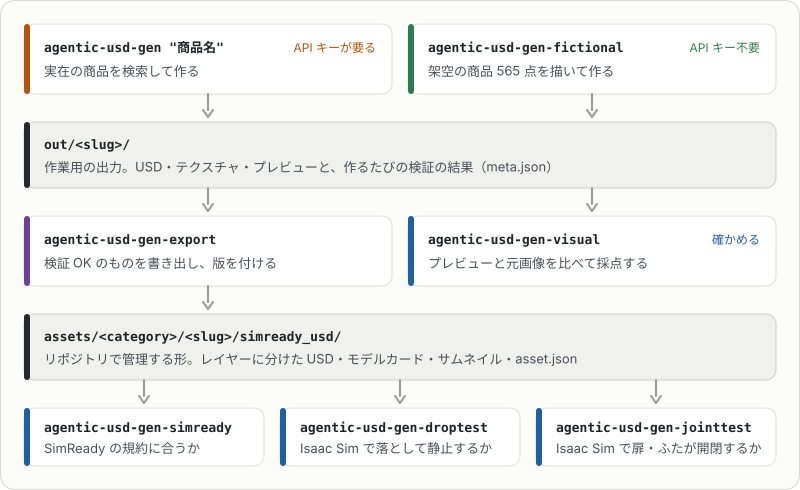

# 準備と使い方

入れ方、APIキーが要る場合、2つのコマンドの使い方とオプションです。言葉の意味は[用語](glossary.md)にまとめています。

## 準備

- Python 3.12以上と[uv](https://docs.astral.sh/uv/)
- Blender 4.x（macOSは`/Applications/Blender.app`に置くか、`--blender` / 環境変数`BLENDER`で場所を指定。Windows・Ubuntuは[プレビュー](preview.md)）
- Anthropic APIキー（実在の商品を検索して新しく作るときだけ。下記）

Isaac Simは、作る・書き出す・SimReadyの検証には要りません。要るのは、任意の確認である落下テストと関節の開閉テストだけです（[検証](validation.md)）。

```sh
git clone https://github.com/atinfinity/agentic-usd-gen.git && cd agentic-usd-gen
uv sync
cp .env.example .env   # 商品名から検索して作るときだけ。ANTHROPIC_API_KEY=... を記入
```

架空の商品だけを作るなら、`.env`は要りません。

> [!IMPORTANT]
> `src/agentic_usd_gen/blender/`のスクリプトはBlenderの中で動き、BlenderのPython API（`bpy`）を使います。Blender本体は含みません。

> [!WARNING]
> APIキーを使う処理には、Anthropic APIの料金がかかります（既定のモデルは`claude-opus-5-5`）。

APIキーを使うのは、商品名から寸法・形状・画像を検索するとき（`search.py`）、画像から使う1枚とキャップ・ラベルの位置を決めるとき（`vision.py`）、`--visual-check`で見た目を採点するときです。次の場合はキーがなくても動き、料金はかかりません。

- 検索キャッシュ（`cache/<商品名>/`の`spec.json`・`vision.json`）がある商品の作り直し（`--refresh`を付けない限り検索しない）
- `agentic-usd-gen-fictional`（架空の商品。キャッシュを自分で書いてから生成する）
- `agentic-usd-gen-export`、テスト
- `--dims`と`--image`で寸法と画像を手で渡したとき（検索を省略し、部位の位置は経験則で決める）

## 使い方

実在の商品を検索して作る例です。

```sh
uv run agentic-usd-gen "緑茶 600ml PET" --usdz --preview
```

`<商品名>`には検索したい商品の名前を入れます。空白を含むときは引用符で囲みます。

架空の商品を作る例です（APIキーは要りません）。

```sh
uv run agentic-usd-gen-fictional soda_pet_500ml --out out/fictional --preview
```

- `soda_pet_500ml`は作る商品の名前（slug）です。ほかのslugに替えたり、空白で区切っていくつも並べたりできます。`--all`を付けると565点すべてを作ります。
- 指定できるslugは`uv run agentic-usd-gen-fictional --list`で、分類・形状・品名と一緒に一覧できます（何も作りません）。後ろに語を並べると絞り込めます（例: `--list pouch food`）。分野ごとのまとめは[架空の商品](fictional.md)にあります。
- 下の表のオプションは、`--dims`・`--image`・`--slug`・`--refresh`など検索して作るとき専用のものを除いて、`agentic-usd-gen-fictional`にもそのまま渡せます。

`agentic-usd-gen`のオプション:

| オプション | 説明 |
|---|---|
| `--out DIR` | 出力先（既定`out/`）。アセットは`<出力先>/<slug>/`にできる（[出力](output.md)） |
| `--cache DIR` | 検索結果と画像を置くキャッシュ（既定`cache/`） |
| `--blender PATH` | Blenderの実行ファイルの場所 |
| `--dims H=0.205,D=0.065[,CAP_H=..,CAP_D=..,T=..]` | 寸法を上書き（メートル）。袋はHがシール間の長さ、Dが幅、Tが厚さ。箱はDが正面の横幅、Tが奥行き |
| `--image PATH` | 側面画像を直接指定する（複数指定可）。指定するとダウンロードしない |
| `--slug NAME` | 出力名とルートPrim名 |
| `--orientation upright\|lying` | 置き方（袋のみ。既定は`spec.json`の`orientation`、なければ`upright`） |
| `--refresh` | キャッシュを使わず検索し直す |
| `--model` | Claudeのモデル（既定`claude-opus-5-5`） |
| `--usda` / `--usdz` | テキスト版 / Quick Look用usdzも書き出す |
| `--preview` | Blender（Cycles）で正面・斜め・上からのプレビューを描画する |
| `--visual-check` | プレビューと元画像を画像認識で比べ、見た目の点数を`meta.json`に書く（`--preview`とAPIキーが要る。[見た目の検証](validation.md#見た目の検証)） |
| `--no-physics` | 剛体・質量・コリジョンを付けない |

形状ごとの寸法の決め方と、`spec.json`に書ける項目（部品・関節・照明・バリアントなど）は[形状とspec.json](shapes.md)にあります。

作ったあとは、`agentic-usd-gen-export`でリポジトリ管理用の形に書き出し、検証のコマンドで確かめます。


