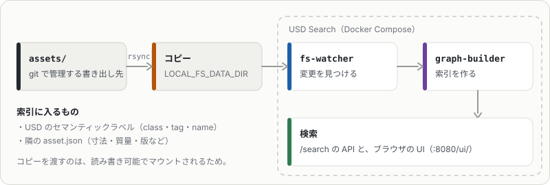

# USD Searchでassets/ を検索する

[NVIDIA USD Search](https://github.com/NVIDIA-Omniverse/usd-search)を手元で動かし、`agentic-usd-gen-export`で書き出した`assets/`だけを検索対象にする設定例です。
USD SearchはLinux＋Docker Compose（画像検索・サムネイル描画にはNVIDIA GPU）で動きます。Macでは動かないので、Linux機に`assets/`を置いて使います。

> [!WARNING]
> この設定とコマンドはusd-searchのソースを読んで組み立てたもので、Linux＋GPUの実機では動かしていません（[確認していないこと](#確認していないこと)）。

## agentic-usd-genが書き込む検索用の情報

`agentic-usd-gen-export`は書き出し先のUSDのルートPrimに次を書きます。

| 場所 | 中身 | 使われ方 |
|---|---|---|
| `assetInfo` | `name`（slug）・`version`・`displayName`（日本語名）・`category`・`tags`・`description` | Omniverse / Isaac Simのアセット情報。USD Searchの索引には入らない |
| `displayName`・`documentation` | 日本語名と1文の説明 | Isaac SimのステージツリーとUI |
| `semantic:<inst>:params:semanticType/semanticData` | `class` = カテゴリ、`tag` = 各タグ、`name` = 日本語名 | Isaac Sim（旧形式）のReplicatorのラベル。USD Searchの既定の索引対象 |
| `semantics:labels:class` / `semantics:labels:tag` | `UsdSemantics.LabelsAPI`のラベル | Isaac Sim 5以降のReplicatorのラベル |
| 同じディレクトリの`asset.json` | 寸法・質量・物理・出典・版など全部 | サイドカー設定を入れるとUSD Searchの索引に入る |

タグの中身と足し方は[タグ](export.md#タグ)にあります。

## 起動



usd-searchのリポジトリで、ローカルのディレクトリをそのままストレージにする`local-fs`構成を使い、このリポジトリの設定を重ねます。

```bash
git clone https://github.com/NVIDIA-Omniverse/usd-search.git && cd usd-search

export LOCAL_FS_DATA_DIR=/srv/agentic-usd-gen-assets               # 検索対象（assets/ のコピー。下の注意を参照）
export AGENTIC_USD_GEN_DOCS_DIR=/path/to/agentic-usd-gen/docs/usd-search   # このリポジトリの docs/usd-search

rsync -a --delete /path/to/agentic-usd-gen/assets/ "$LOCAL_FS_DATA_DIR"/

# CPU のみ
docker compose -f docker-compose.yml -f docker-compose.local-fs.yml \
  -f "$AGENTIC_USD_GEN_DOCS_DIR"/docker-compose.agentic-usd-gen.yml up --build -d

# GPU あり（画像の埋め込み・サムネイル）
docker compose -f docker-compose.yml -f docker-compose.gpu-plugins.yml \
  -f docker-compose.local-fs.yml -f docker-compose.local-fs.gpu.yml \
  -f "$AGENTIC_USD_GEN_DOCS_DIR"/docker-compose.agentic-usd-gen.yml up --build -d
```

- **対象をassets/ だけに絞る**: `LOCAL_FS_DATA_DIR`に渡したディレクトリだけが索引の対象になります。`out/`（作業用、検証前のものを含む）・`cache/`・`recipes/`は渡しません。
- **コピーを渡す理由**: `local-fs`構成のs3proxyは`LOCAL_FS_DATA_DIR`を読み書き可能（`:rw`）でマウントします。API経由のアップロードや削除がそのまま反映されるので、git管理の`assets/`を直接渡さず、`rsync`したコピーを渡します。
- **更新の反映**: `fs-watcher`がディレクトリの変更を見て索引を作り直すので、`agentic-usd-gen-export`のあと`rsync`し直すだけです。
- **索引から外れるもの**: `.thumbs/`は既定で索引から外れます（サムネイルとして使われます）。

### docker-compose.agentic-usd-gen.ymlの中身

`graph-builder`に次の3つを設定します（[docker-compose.agentic-usd-gen.yml](usd-search/docker-compose.agentic-usd-gen.yml)）。

| 環境変数 | 値 | 意味 |
|---|---|---|
| `INDEXED_PROPERTY_PREFIXES` | `semantic:,semantics:,isaac:,physics:` | 名前がこれで始まる属性を索引に入れる。既定の構成は`semantic:`まで。`semantics:`（LabelsAPI）を足す |
| `USE_SEMANTICS_API` | `True` | 旧形式のラベルを`class`・`tag`・`name`の名前にまとめる（同じ種類が複数あればカンマ区切り）。既定の構成は`False`で、属性名のまま入る |
| `SIDECAR_METADATA_CONFIG_PATH` | `/app/sidecar_metadata.agentic-usd-gen.yaml` | [サイドカー設定](usd-search/sidecar_metadata.agentic-usd-gen.yaml)。同じディレクトリの`asset.json`を`agentic_usd_gen_`を付けて平らにして入れる |

サイドカーで入るプロパティの例（`assets/food/cup_noodle_tall/simready_usd/asset.json`の場合）:

```
agentic_usd_gen_name        = カップめん みそ味
agentic_usd_gen_category    = food
agentic_usd_gen_version     = 1.0.0
agentic_usd_gen_mass_kg     = 0.095
agentic_usd_gen_tags__0     = food
agentic_usd_gen_tags__5     = カップめん
agentic_usd_gen_description = カップめん みそ味（食品）の 3D モデル。回転体、外形 96.0 × 96.0 × 105.0 mm …
```

リストは`__0`・`__1` … の添字付きで入るので、タグで絞り込むときはセマンティックラベルの`tag`を使います。

## 検索の例

ブラウザでは`http://<host>:8080/ui/`から検索できます。APIはゲートウェイ（既定`http://localhost:8080`）の`/search`に問い合わせます（詳細はusd-searchの`docs/`とOpenAPI）。

```bash
# 文章で検索（キャプション・タグ・画像の埋め込みの組み合わせ）
curl -s -X POST localhost:8080/search -H 'Content-Type: application/json' \
  -d '{"description": "カップ麺", "file_extension_include": "usd", "limit": 10}'

# カテゴリで絞り込み（セマンティックラベルの class）
curl -s -X POST localhost:8080/search -H 'Content-Type: application/json' \
  -d '{"description": "デジタルサイネージ", "filter_by_properties": "class=fixture", "limit": 10}'
```

- 拡張子は`usd`に絞ります。`.usda`・`.usdz`は`assets/`にはありませんが、`out/`を渡した場合の重複を防げます。
- `filter_by_properties`に書けるキーは、索引に入ったプロパティ名（`class`・`tag`・`agentic_usd_gen_category`など）です。

## 確認していないこと

- 上の設定とコマンドは、usd-searchのソース（composeファイル・`graph_builder/usd_deps.py`・`sidecar_metadata.py`）を読んで組み立てたものです。Linux＋GPUの実機では動かしていません。
- サイドカー設定のファイルはusd-searchの読み込み処理で読めること、`asset.json`が上のように平らになることは確認済みです。
- `semantics:labels:*`（トークンの配列）が索引でどう文字列化されるかは未確認です。
